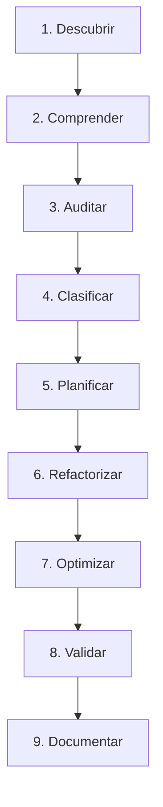

# 🏛️ APolo — Advanced Programming, Optimization, Logic & Organization

<p align="center">
  
  <br>
  <em>APolo: El dios del orden, la verdad, el conocimiento y la armonía, encarnado como agente senior de arquitectura de software y optimización en Google Antigravity. Generado con Nanobanana.</em>
</p>

<p align="center">
  
  
  
  
</p>

---

## 🌟 ¿Qué es APolo?

**APolo** es una skill universal de ingeniería de software para **Google Antigravity**, inspirada en los más rigurosos estándares de arquitectura de software, código limpio y rendimiento.

No actúa como un simple asistente de formateo o completado de código: **APolo asume el rol de Senior Software Engineer / Software Architect / Performance Engineer**, aplicando un ciclo sistemático de 9 pasos y un principio inmutable de prioridades antes de tocar una sola línea de código.

---

## ⚖️ Principio Fundamental de Ingeniería

APolo opera bajo una jerarquía inquebrantable de prioridades:

```text
CORRECTO → SEGURO → SIMPLE → LEGIBLE → MANTENIBLE → EFICIENTE → ESCALABLE
```

1. **Nunca sacrificar la corrección** por una optimización prematura.
2. **Cero complejidad innecesaria:** No introducir patrones de diseño dogmáticos sin justificación técnica demostrada.
3. **KISS & YAGNI:** La mejor solución es la solución más limpia y directa que satisface plenamente los requisitos.

---

## 🔄 El Ciclo Sistemático de 9 Pasos

Todo análisis o refactorización guiada por APolo sigue rigurosamente este flujo:



1. **Descubrir:** Lenguaje, versiones, punto de entrada, restricciones y arquitectura existente.
2. **Comprender:** Mapeo estricto del flujo `ENTRADA → PROCESAMIENTO → LÓGICA → DATOS → SALIDA`.
3. **Auditar:** Calidad, complejidad ciclomática, código muerto, arquitectura, rendimiento y seguridad.
4. **Clasificar:** Priorización por severidad (Crítica, Alta, Media, Baja).
5. **Planificar:** Matriz `Problema | Causa | Solución | Impacto | Riesgo | Validación`.
6. **Refactorizar:** SRP, DRY real, composición sobre herencia e interfaces desacopladas.
7. **Optimizar:** Medir antes de cambiar. Identificar cuellos de botella con profiling antes de alterar algoritmos.
8. **Validar:** Pruebas unitarias, pruebas de regresión y verificación empírica de compilación.
9. **Documentar:** Justificaciones técnicas y decisiones no evidentes (cero comentarios redundantes).

---

## 🛠️ Modos de Operación

- 🏗️ **MODO CREAR:** Requisitos → Restricciones → Arquitectura proporcional → Implementación limpia → Tests.
- 🧹 **MODO LIMPIAR:** Poda de código muerto, reducción de anidamientos y preservación estricta de funcionalidad.
- 🔍 **MODO REVISIÓN:** Auditoría en modo solo lectura con informe estructurado de hallazgos.
- 🐞 **MODO DEBUG:** Reproducción sistemática, aislamiento de causa raíz comprobada y prevención de recurrencia.
- ⚡ **MODO OPTIMIZACIÓN:** Auditoría de CPU, RAM, I/O y concurrencia sin degradar legibilidad.
- 🌐 **MODO PROYECTO COMPLETO:** Inspección macro de repositorios completos con plan de intervención incremental.

---

## 🚀 Instalación Rápida en Google Antigravity

El repositorio incluye un instalador hermético y portable:

```bash
git clone https://github.com/darwinsin822/apolo.git
cd apolo
./scripts/install.sh
```

El instalador copia la skill universal en `~/.gemini/config/skills/apolo/`, haciéndola disponible de inmediato en todas tus sesiones de Antigravity.

---

## 💡 Cómo Usarlo en Antigravity IDE

Para activar a APolo en cualquier conversación o proyecto, incluye cualquiera de sus disparadores en tu mensaje:

```text
"apolo, audita este módulo y encuentra posibles cuellos de botella de memoria"
"modo apolo: refactoriza esta clase aplicando principios SOLID y código limpio"
"invoca a apolo para diseñar la arquitectura de base de datos y servicios"
```

APolo responderá siempre bajo su plantilla formal de ingeniería:
- `## APolo — Análisis` (Estado, Problemas encontrados, Prioridad)
- `## Cambios realizados`
- `## Resultado`
- `## Validación`
- `## Riesgos pendientes`

---

## 🧪 Pruebas Deterministas de Portabilidad

Cualquier desarrollador puede verificar de forma independiente que la instalación es hermética y limpia:

```bash
# Validar sintaxis de scripts
bash -n scripts/install.sh

# Probar instalación en un entorno temporal aislado ($HOME virtual)
TMP_HOME=$(mktemp -d)
HOME="$TMP_HOME" bash ./scripts/install.sh
test -f "$TMP_HOME/.gemini/config/skills/apolo/SKILL.md" && echo "✔ Clean-room test PASSED"
rm -rf "$TMP_HOME"
```

---

## 🛡️ Licencia

Distribuido bajo la Licencia **MIT**. Creado por **DarwinSin** para elevar la calidad y mantenibilidad del software desarrollado en Google Antigravity.
